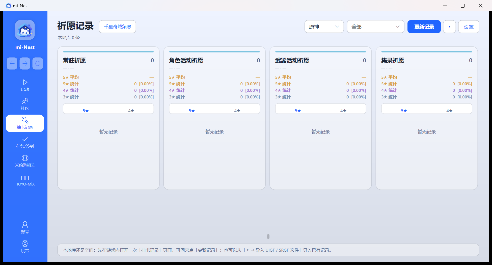
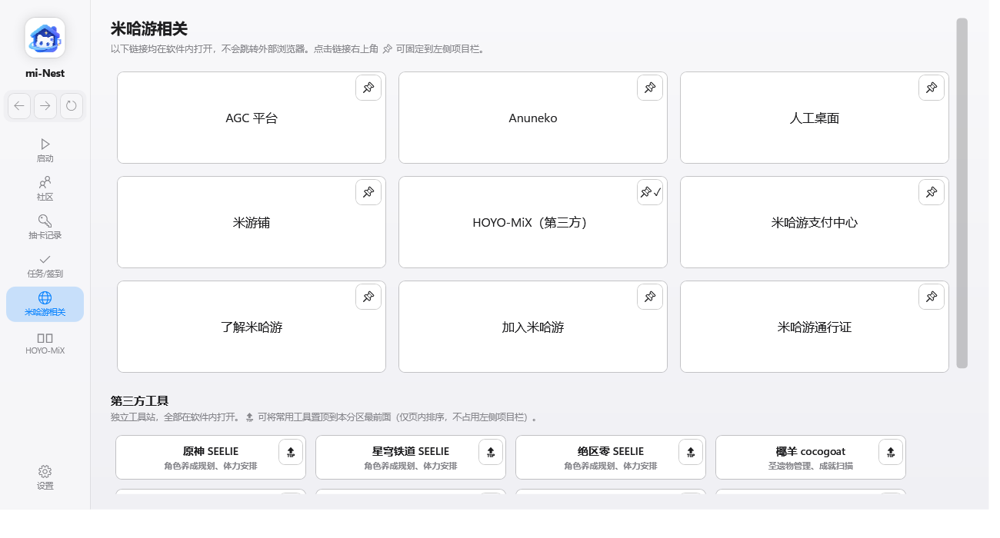
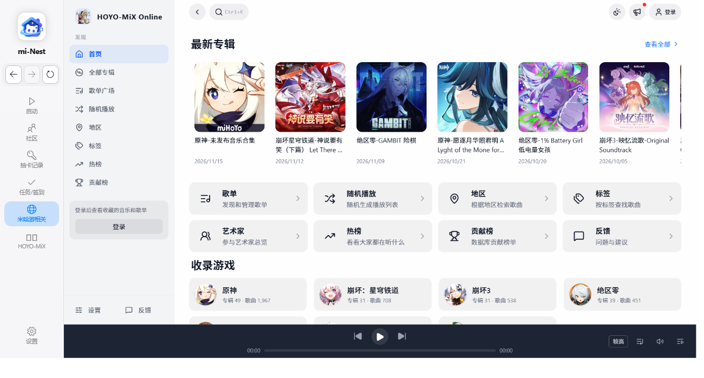
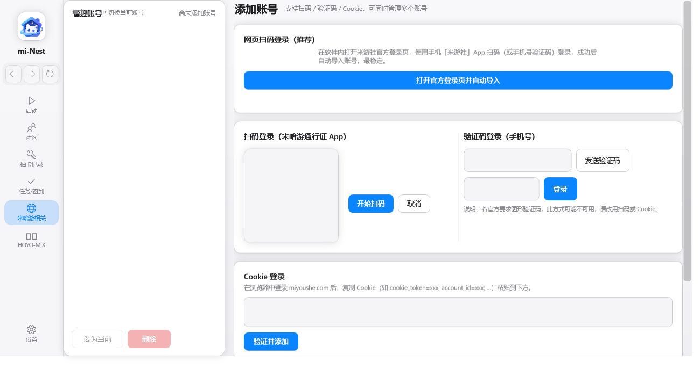

<p align="center">
  
</p>

# mi-Nest

> 米哈游 PC 多功能桌面客户端（开源）· 基于 WPF + WebView2 · 支持 Visual Studio 2022 / .NET 9

mi-Nest 是一个**全部页面都在软件内部展示**的桌面应用：把米哈游生态装进一个软件 —— 启动游戏、逛社区、抽卡记录、每日签到，全都在一个窗口里完成，不用来回开浏览器和客户端。左侧导航栏从上到下依次为 Logo + 名称、网页（后退/向前/刷新）、启动、社区、抽卡记录、任务/签到、米哈游相关、HOYO-MiX、账号、设置。社区、米哈云游、预约游戏、官方平台与第三方工具等网页全部通过内嵌 WebView2 打开，**不会跳转到外部浏览器**。

**免责声明**：
本项目为个人开源项目，与米哈游官方无关。任务 / 签到等接口为社区公开接口，官方可能随时调整导致部分功能失效，届时需要更新参数后才能继续使用。此外，本软件聚合了大量第三方工具与站点，它们由各自的开发者独立维护，其任何问题（包括服务可用性、数据安全、使用后果等）均与本软件无关，请在使用前自行了解其用途与风险。请勿滥用接口，注意账号安全。

## 界面预览

### 启动

内嵌米哈游官方启动器：原神 / 星穹铁道 / 绝区零 / 崩坏3 四游戏独立背景，支持获取游戏、打开官方网址、独立更换背景、米哈云游与预约游戏入口。


### 抽卡记录

Starward 同款获取方式（authkey 自动提取），登录后自动识别账号绑定的游戏，跨游戏统一管理，支持 UIGF 导出。



### 任务/签到

TeyvatGuide 同款实用脚本：米游币每日任务（打卡 / 绑定角色 / 改签名，含今日进度与米游币余额）、各游戏角色签到（原神 / 星穹铁道 / 绝区零 / 崩坏3 / 崩坏学园2 / 未定事件簿）、可勾选角色、多账号一键执行，右侧实时滚动输出日志。


### 米哈游相关

全部官方平台入口 + 12 项第三方工具（可固定到左侧项目栏）。



### HOYO-MiX

第三方米哈游音乐平台（可固定到左侧项目栏）。



### 账号

扫码 / 验证码 / Cookie 登录，多账号管理。



### 设置

界面配色（黑/白/崩2橙/崩3蓝/未定冷等米哈游主题）、管理项目栏、数据目录、更新/卸载。


## 功能

- **启动**：内嵌米哈游官方启动器（原神 / 星穹铁道 / 绝区零 / 崩坏3），支持获取游戏、打开官方网址、独立更换背景、米哈云游与预约游戏入口
- **社区**：内嵌米游社
- **抽卡记录**：Starward 同款获取方式（authkey 自动提取），登录后自动识别账号绑定的游戏，跨游戏统一管理，支持 UIGF 导出
- **任务/签到**：TeyvatGuide 同款实用脚本，米游币每日任务（打卡 / 绑定角色 / 改签名，含进度与米游币余额）+ 六款游戏角色签到（可勾选）+ 多账号一键执行 + 实时输出日志
- **米哈游相关**：全部官方平台入口 + 12 项第三方工具（可固定到左侧项目栏）
- **HOYO-MiX**：第三方音乐平台（可固定到左侧项目栏）
- **账号**：扫码 / 验证码 / Cookie 登录，多账号管理
- **设置**：界面配色（黑/白/崩2橙/崩3蓝/未定冷等米哈游主题）、管理项目栏、隐藏设置（视频/追剧开关）、数据目录、更新/卸载

## 技术栈

- .NET 9（net9.0-windows）、WPF、WebView2（Microsoft.Web.WebView2）
- QRCoder（扫码登录二维码）、System.Security.Cryptography.ProtectedData（Cookie 加密）
- Visual Studio 2022（17.x）或 `dotnet CLI` 均可构建

## 界面截图
- 启动页（原神背景 + 完整左侧导航 + 开始游戏 / 定位游戏 + 预约游戏）
 
- 米游社
 
- 米哈游相关（官方平台 + 第三方工具）
 
- HOYO-MiX（第三方）
 
- 卸载确认弹窗（胡桃风格）
 
- 米哈游官方其他内容
 
 
 


## 构建与运行

### 方式一：Visual Studio 2022

1. 安装 **.NET 9 SDK** 与 **Visual Studio 2022**（勾选“.NET 桌面开发”工作负载）。
2. 打开 `mi-Nest.sln`，还原 NuGet 包（需要联网），直接 F5 运行。

### 方式二：命令行

```bash
dotnet build mi-Nest.sln -c Debug
dotnet run --project src/mi-Nest
```

> 依赖 WebView2 Runtime（Windows 10/11 一般随 Edge 自动安装；也可到 Microsoft 官网单独安装 Evergreen 运行时）。

## 接口与维护说明（重要）

- 米游币任务、签到、登录等调用的是**社区公开接口**，其中的 `DS 盐值`、`AppVersion`、`gid/forum_id` 等常量集中在 `Services/MiHoYoHttp.cs`、`SignService.cs` 中；米哈游官方可能随时调整，导致 `-1 / 1034 / -5003` 等返回码，届时按社区最新参数同步更新即可。
- 抽卡 authkey 有效期约 24 小时，过期后需重新在游戏内打开一次抽卡记录页面。
- 验证码登录在官方要求图形验证码时可能不可用，请改用扫码或 Cookie 登录。

## 免责声明

本项目与米哈游官方**无任何关联**，仅供学习与个人使用。该软件存在大量第三方工具，第三方工具的任何问题都与本软件无任何关系。请遵守米哈游用户协议，勿对接口进行高频滥用；账号与数据安全请自行负责。

## 开源协议

[MIT License](LICENSE) — 参考项目 Starward / TeyvatGuide 均为 MIT 协议。
