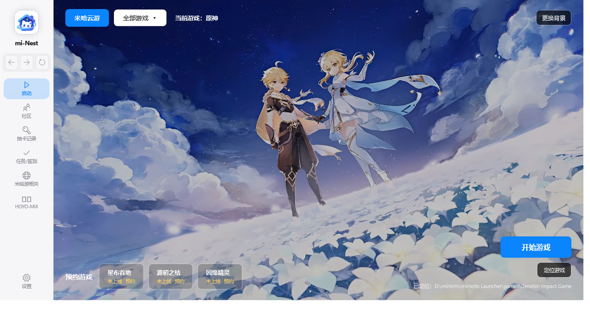
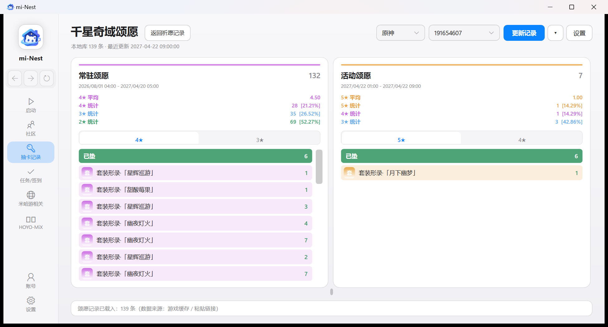
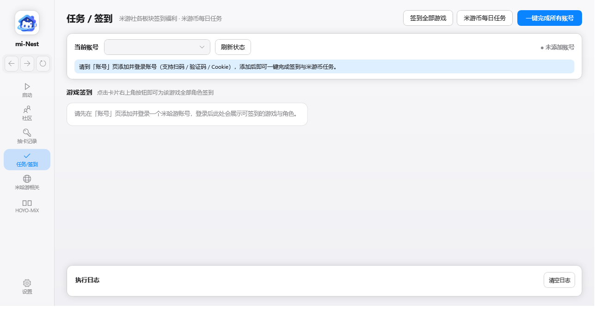
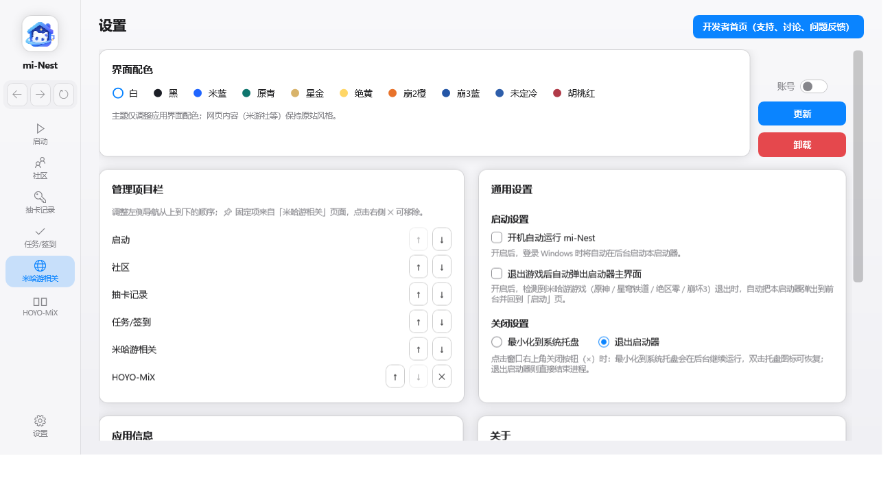

<p align="center">
  
</p>

# MikoNest

> 米哈游 PC 多功能桌面客户端（开源）· Windows 版基于 WPF + WebView2，macOS 版基于 Avalonia 11 · .NET 9

MikoNest 是一个**全部页面都在软件内部展示**的桌面应用：把米哈游生态装进一个软件 —— 启动游戏、逛社区、抽卡记录、每日签到，全都在一个窗口里完成，不用来回开浏览器和客户端。左侧导航栏从上到下依次为 Logo + 名称、网页（后退/向前/刷新）、启动、社区、抽卡记录、任务/签到、米哈游相关、HOYO-MiX、账号、设置。社区、米哈云游、预约游戏、官方平台与第三方工具等网页全部通过内嵌 WebView2 打开，**不会跳转到外部浏览器**。

**免责声明**：
本项目为个人开源项目，与米哈游官方无关。任务 / 签到等接口为社区公开接口，官方可能随时调整导致部分功能失效，届时需要更新参数后才能继续使用。此外，本软件聚合了大量第三方工具与站点，它们由各自的开发者独立维护，其任何问题（包括服务可用性、数据安全、使用后果等）均与本软件无关，请在使用前自行了解其用途与风险。请勿滥用接口，注意账号安全。

## 下载

前往 [Releases](https://github.com/Huiusto/mi-Nest/releases/latest) 获取安装包：

| 平台 | 文件 |
| --- | --- |
| Windows 10/11 x64 | `MikoNest-Setup-0.1.28.exe`（安装程序） |
| macOS Apple Silicon | `MikoNest-<version>-osx-arm64.zip` |
| macOS Intel | `MikoNest-<version>-osx-x64.zip` |

## 界面预览

### 启动

内嵌米哈游官方启动器页面：原神 / 星穹铁道 / 绝区零 / 崩坏3 各取官方当前版本的全部壁纸（含 `.webm` 动态壁纸，通过 WebView2 原生播放），画面无遮罩；鼠标移到左边缘浮现「‹ / › 切换、圆点跳转、保存壁纸、暂停动态」控制条。四个游戏各自独立判断运行状态：点「开始游戏」后按钮变为「游戏启动中」并一直保持，直到该游戏进程真正退出才恢复，期间可继续启动其他游戏。支持预下载提示、安装游戏（弹出安装窗口）、定位游戏、米哈云游与预约游戏入口。



### 抽卡记录

仿 Starward「祈愿记录 / 跃迁记录 / 调频记录」的分列式统计：按卡池分列（原神为常驻 / 角色 / 武器 / 集录，星铁为群星 / 角色活动 / 光锥活动 / 联动，绝区零为常驻 / 独家 / 音擎 / 邦布），每列给出总抽数、时间区间、5★ 平均、5★ / 4★ / 3★ 的数量与占比，并逐条列出 5★ / 4★ 记录及其保底计数（「已垫」抽数按绿 / 橙 / 红三档着色）。支持游戏与 UID 切换、从游戏 webCaches 一键更新（authkey 约 24 小时有效）、粘贴链接、从登录账号获取、导入 / 导出 UIGF / SRGF / CSV。


原神「祈愿记录」标题右侧还有「千星奇域颂愿」入口：仿 Starward 分两列统计**常驻颂愿 / 活动颂愿**，给出总抽数、时间区间、4★ 平均、4★ / 3★ / 2★ 数量与占比，并列出 4★ / 3★ 记录与「已垫」抽数；记录单独入库，不会与普通祈愿统计混在一起。



### 任务/签到

TeyvatGuide 同款实用脚本：米游币每日任务（打卡 / 绑定角色 / 改签名，含今日进度与米游币余额）、各游戏角色签到（原神 / 星穹铁道 / 绝区零 / 崩坏3 / 崩坏学园2 / 未定事件簿）、可勾选角色、多账号一键执行，右侧实时滚动输出日志。



### 米哈游相关

全部官方平台入口 + 12 项第三方工具（可固定到左侧项目栏）。


### HOYO-MiX

第三方米哈游音乐平台（可固定到左侧项目栏）。


### 账号

扫码 / 验证码 / Cookie 登录，多账号管理。


### 设置

界面不透明度滑条（0-100，实时调整卡片与输入框底色）、界面配色（白/黑/米蓝/原青/星金/绝黄/崩2橙/崩3蓝/未定冷/胡桃红）、账号开关、管理项目栏、数据目录、更新/卸载。



## 功能

- **启动**：内嵌米哈游官方启动器（原神 / 星穹铁道 / 绝区零 / 崩坏3），背景自动跟随官方启动器（HoYoPlay）下发的版本壁纸 / 动态视频（6 小时自动核对一次，也可自行更换背景），米哈云游与预约游戏入口；重复双击图标时会把已最小化的窗口还原到桌面，不再弹「请勿重复启动」
- **社区**：内嵌米游社
- **抽卡记录**：按卡池分列统计（总抽数、时间区间、5★ 平均、5★/4★/3★ 占比），逐条 5★/4★ 记录带保底计数；游戏 / UID 切换、游戏缓存一键更新、导入 / 导出 UIGF / SRGF / CSV
- **任务/签到**：TeyvatGuide 同款实用脚本，米游币每日任务（打卡 / 绑定角色 / 改签名，含进度与米游币余额）+ 六款游戏角色签到（可勾选）+ 多账号一键执行 + 实时输出日志
- **米哈游相关**：全部官方平台入口 + 12 项第三方工具（可固定到左侧项目栏）
- **HOYO-MiX**：第三方音乐平台（可固定到左侧项目栏）
- **账号**：扫码 / 验证码 / Cookie 登录，多账号管理
- **设置**：界面配色（黑/白/崩2橙/崩3蓝/未定冷等米哈游主题）、管理项目栏、隐藏设置（视频/追剧开关）、数据目录、更新/卸载

## 技术栈

- .NET 9（net9.0-windows）、WPF、WebView2（Microsoft.Web.WebView2）
- QRCoder（扫码登录二维码）、System.Security.Cryptography.ProtectedData（Cookie 加密）
- Visual Studio 2022（17.x）或 `dotnet CLI` 均可构建

## 界面截图
- 启动页（原神背景 + 完整左侧导航 + 开始游戏 / 定位游戏 + 预约游戏）
 
- 米游社
 
- 米哈游相关（官方平台 + 第三方工具）
 
- HOYO-MiX（第三方）
 
- 卸载确认弹窗（胡桃风格）
 
- 米哈游官方其他内容
 
 
 


## 构建与运行

### 方式一：Visual Studio 2022

1. 安装 **.NET 9 SDK** 与 **Visual Studio 2022**（勾选“.NET 桌面开发”工作负载）。
2. 打开 `mi-Nest.sln`，还原 NuGet 包（需要联网），直接 F5 运行。

### 方式二：命令行

```bash
dotnet build mi-Nest.sln -c Debug
dotnet run --project src/mi-Nest
```

> 依赖 WebView2 Runtime（Windows 10/11 一般随 Edge 自动安装；也可到 Microsoft 官网单独安装 Evergreen 运行时）。

## 接口与维护说明（重要）

- 米游币任务、签到、登录等调用的是**社区公开接口**，其中的 `DS 盐值`、`AppVersion`、`gid/forum_id` 等常量集中在 `Services/MiHoYoHttp.cs`、`SignService.cs` 中；米哈游官方可能随时调整，导致 `-1 / 1034 / -5003` 等返回码，届时按社区最新参数同步更新即可。
- 抽卡 authkey 有效期约 24 小时，过期后需重新在游戏内打开一次抽卡记录页面。
- 启动页背景来自官方启动器接口 `hyp-connect/api/getAllGameBasicInfo`（`launcher_id=jGHBHlcOq1`，国服），实现方式参考 Starward：按游戏 `biz`（hk4e/hkrpg/nap/bh3）取当前版本**全部**背景，图片立即缓存到 `%AppData%\MikoNest\bg`，`.webm` 动态视频在切换到该张壁纸时才按需下载。启动页整页由 WebView2 承载（Chromium 原生解码 VP9 WebM，不依赖系统解码器）：鼠标移到页面左边缘会浮现「‹ / › 切换、圆点跳转、保存壁纸、暂停 / 播放动态壁纸」的控制条，圆点数量与官方下发的背景数量一致；顶部「全部游戏」下拉可按住右侧 `⠿` 拖动调整四款游戏的显示顺序，顺序会保存到 `settings.json`。预下载 / 安装包信息来自 `hyp-connect/api/getGamePackages`。相关代码见 `Services/LauncherBackgroundService.cs`、`Assets/Launch/launch.html`。
- 验证码登录在官方要求图形验证码时可能不可用，请改用扫码或 Cookie 登录。

## 致谢（参考的开源项目）

MikoNest 的多个功能在交互与思路上参考了以下开源项目，实现代码均为本项目自行编写，未直接复制其源码：

| 项目 | 作者 | 协议 | 参考内容 |
| --- | --- | --- | --- |
| [Starward](https://github.com/Scighost/Starward) | Scighost | MIT | 启动页多张官方壁纸 / `.webm` 动态背景、预下载提示、祈愿 / 跃迁记录的分池统计与「已垫 / UP」展示、首页背景服务思路 |
| [TeyvatGuide](https://github.com/BTMuli/TeyvatGuide) | BTMuli | MIT | 「实用脚本」式的米游币任务与全角色签到交互（一键执行当前账号 / 全部账号、任务清单与输出日志） |
| [Snap.Hutao](https://github.com/DGP-Studio/Snap.Hutao) | DGP-Studio | GPL-3.0 | 米哈游接口参数与社区资料（仅作接口常量对照，未引入其代码） |

同时感谢米哈游官方启动器公开的 `hyp-connect` 接口与社区维护的接口文档。
## 平台支持

- **Windows 10/11（x64）**：主版本，WPF + WebView2 + .NET 9，自包含发布，无需安装 .NET 运行时。下载 `MikoNest-Setup-0.1.28.exe` 安装包即可。
- **macOS 11+**：Avalonia 11 跨平台版，提供 Apple Silicon（arm64）与 Intel（x64）两个 `.app` 包，功能为启动页、抽卡统计、设置、账号 / 任务 / 米哈游相关入口。与 Windows 版共用 `settings.json`、`gacha_records.json` 结构。未做代码签名，首次运行需在终端执行 `xattr -cr MikoNest.app` 与 `chmod +x MikoNest.app/Contents/MacOS/MikoNest`，详见 [docs/AVALONIA-macOS.md](docs/AVALONIA-macOS.md)。
- **跨平台版当前差异**：`.webm` 动态壁纸暂以静态封面呈现；游戏内抽卡缓存抓取、账号登录 / 签到、预下载进度仍由 Windows 版提供。

## 免责声明

本项目与米哈游官方**无任何关联**，仅供学习与个人使用。该软件存在大量第三方工具，第三方工具的任何问题都与本软件无任何关系。请遵守米哈游用户协议，勿对接口进行高频滥用；账号与数据安全请自行负责。

## 开源协议

[MIT License](LICENSE) — 参考项目 Starward / TeyvatGuide 均为 MIT 协议。


